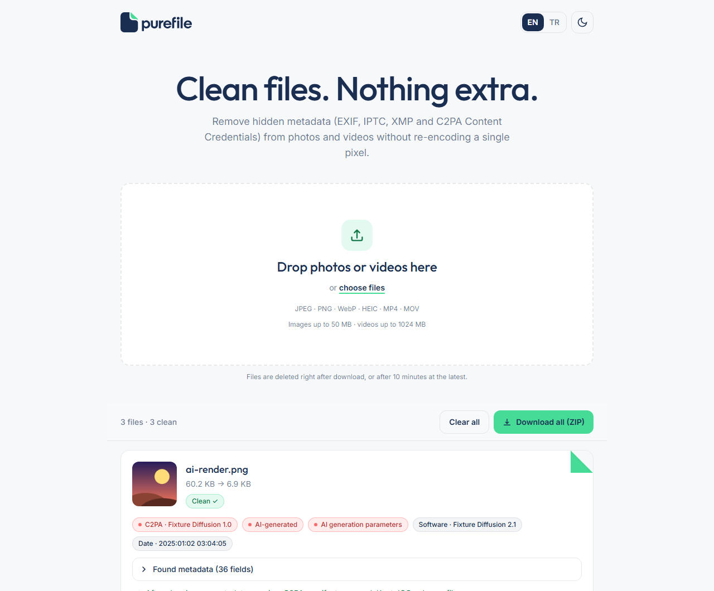
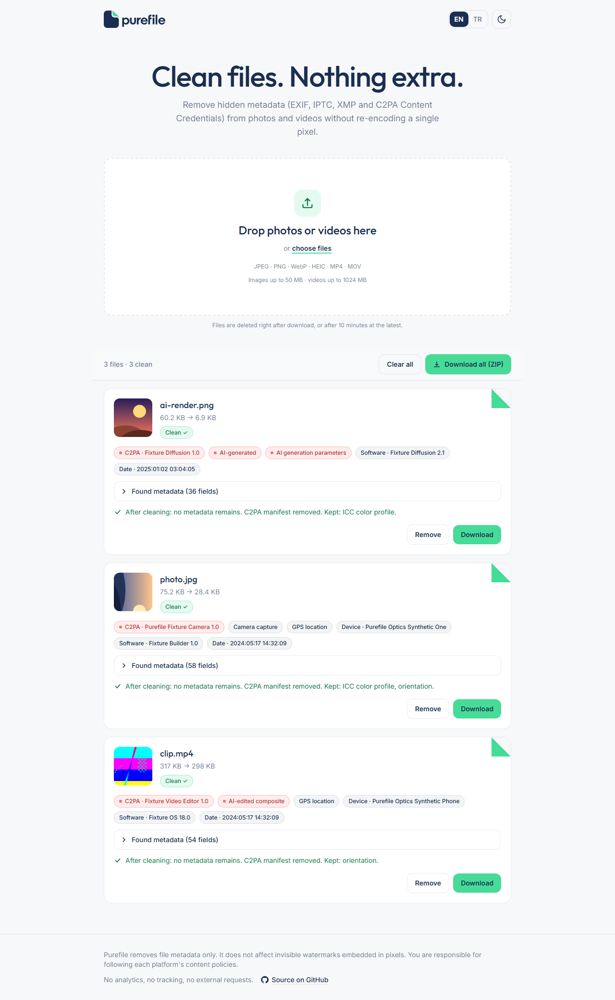
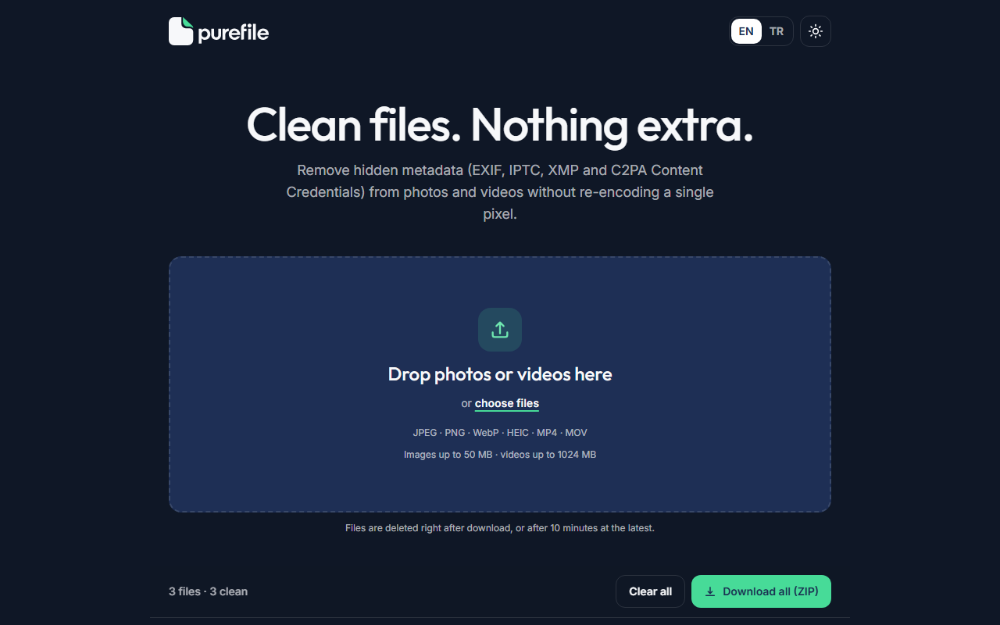
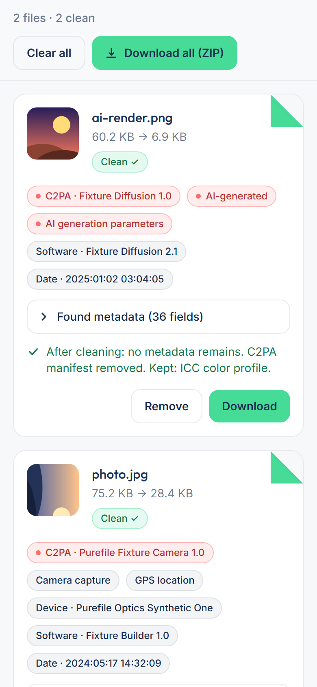
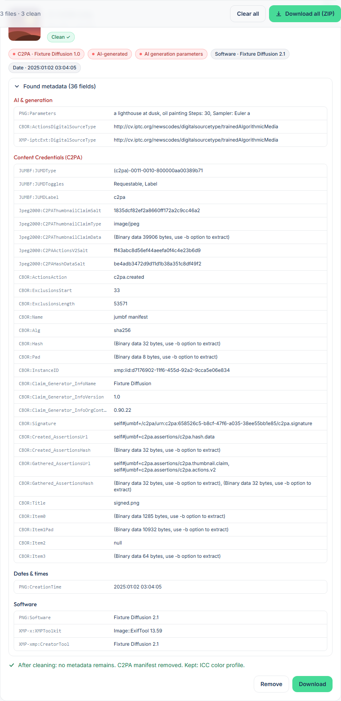
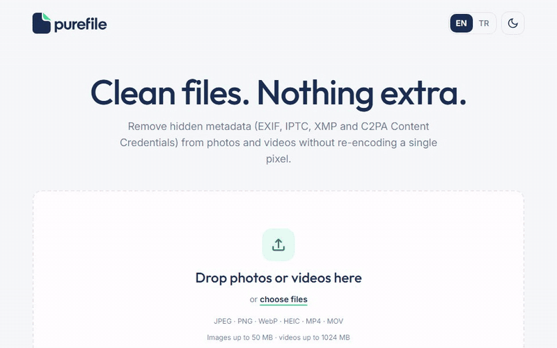
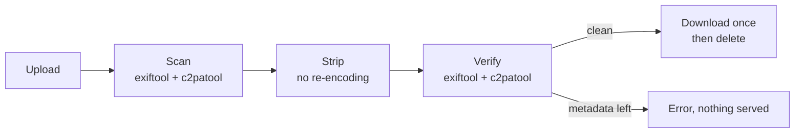

<div align="center">

<picture>
  <source media="(prefers-color-scheme: dark)" srcset="assets/brand/purefile-logo-dark.svg">
  
</picture>

**Clean files. Nothing extra.**

[](LICENSE)
[](https://github.com/tzeytun/purefile/actions/workflows/ci.yml)
[](pyproject.toml)
[](Dockerfile)

</div>

<p align="center">
  
</p>

## What it does

Drop photos or videos into Purefile and it removes the metadata hidden inside them: EXIF, IPTC, XMP and C2PA / Content Credentials manifests. It shows what each file contained, cleans it, checks that nothing is left, and hands back the clean file. Pixels and audio/video streams are copied byte for byte, never re-encoded, so there is no quality loss and cleaning takes seconds.

## Features

- **No re-encoding.** Image data and video/audio streams stay byte-identical.
- **"Before" scan** that groups what a file reveals and flags the important bits with badges: C2PA manifest and its claim generator, AI `DigitalSourceType` (`trainedAlgorithmicMedia`, `compositeWithTrainedAlgorithmicMedia`, ...), AI generation parameters, GPS location, camera/device, software and timestamps.
- **"After" report and verification.** Every output is re-checked with exiftool and c2patool; a file that still holds metadata is never served.
- **Formats:** JPEG, PNG, WebP, HEIC/HEIF, MP4, MOV.
- **Keeps what keeps images correct:** ICC color profiles and orientation (including the rotation of vertical videos).
- **Batch friendly:** multi-file drag and drop, per-file downloads or one ZIP. Cleaned files get `_pure` appended to their name.
- **Private by design:** files live only in a temporary directory, are deleted right after download (and after 10 minutes at the latest), with no analytics, no tracking and no external requests.
- **Mobile-first UI** in English and Turkish, with dark mode and self-hosted fonts.
- **One command to run:** Docker image with exiftool, ffmpeg and c2patool included.

## Screenshots

| Light | Dark |
| --- | --- |
|  |  |

| Mobile | Before / after report |
| --- | --- |
|  |  |



## Supported formats

| Format | What gets removed | What is preserved |
| --- | --- | --- |
| **JPEG** | EXIF, XMP (incl. extended), IPTC/Photoshop, C2PA/JUMBF, comments, other APPn segments, thumbnails, and any data after the image (MPF previews, Ultra HDR gain maps) | Image data (byte-identical), JFIF, ICC profile, Adobe segment (CMYK), orientation |
| **PNG** | `tEXt`, `iTXt`, `zTXt` (incl. XMP and AI generation parameters), `eXIf`, `caBX` (C2PA), `tIME`, unknown ancillary chunks | Image data (byte-identical), `iCCP`/`sRGB`/gamma, transparency, palette, DPI, animation (APNG), orientation |
| **WebP** | EXIF, XMP, C2PA chunks | Bitstream (byte-identical), ICC profile, animation, orientation |
| **HEIC / HEIF** | EXIF and XMP items, C2PA boxes | Coded image data, ICC profile, rotation and mirroring |
| **MP4 / MOV** | Container and stream metadata, GPS and device tags, chapters, cover art, data tracks (timecode, telemetry), XMP, C2PA boxes | Video, audio and subtitle streams (hash-identical), duration, display rotation |

Other types (GIF, AVIF, RAW, PDF, ...) are rejected rather than half-cleaned.

## Quick start

### Docker

```bash
docker run --rm -p 8000:8000 --read-only --tmpfs /tmp:size=3g ghcr.io/tzeytun/purefile:latest
```

Then open <http://localhost:8000>. Or build it yourself with Compose:

```bash
git clone https://github.com/tzeytun/purefile.git
cd purefile
docker compose up --build
```

### Local development

Requires Python 3.12+, Node 20+, and [exiftool](https://exiftool.org), [ffmpeg](https://ffmpeg.org) and [c2patool](https://github.com/contentauth/c2pa-rs/releases) on your `PATH` (or set `PUREFILE_EXIFTOOL_PATH` and friends, see [.env.example](.env.example)).

```bash
python -m venv .venv && source .venv/bin/activate    # Windows: .venv\Scripts\activate
pip install -e ".[dev]"
npm ci && npm run build:css
uvicorn purefile.main:app --reload                   # http://127.0.0.1:8000
```

Run the checks with `ruff check . && mypy && pytest --cov`, or run everything, tools included, in Docker with `docker compose --profile test run --build --rm test`. Test files are generated locally by [scripts/make_fixtures.py](scripts/make_fixtures.py); no photos or videos are committed.

## How it works



1. **Upload:** the file is streamed to a private temporary directory. The format is detected from its bytes, never from its name.
2. **Scan:** exiftool and c2patool list everything embedded, which becomes the "before" report.
3. **Strip:** JPEG, PNG and WebP are rewritten by small pure-Python segment/chunk walkers that copy image data verbatim. HEIC is cleaned with exiftool. MP4/MOV are remuxed with `ffmpeg -map_metadata -1 -map_chapters -1 -c copy`; leftover C2PA/XMP boxes are overwritten in place so no offsets move, and the rotation is checked and restored if needed.
4. **Verify:** the output is scanned again. If anything remains, it is discarded and an error is shown.
5. **Download:** the file is served once and deleted immediately; a cleanup job removes anything older than 10 minutes.

## Configuration

Set these environment variables (or put them in `.env`, see [.env.example](.env.example)).

| Variable | Default | Description |
| --- | --- | --- |
| `PUREFILE_MAX_IMAGE_MB` | `50` | Maximum image upload size, in MB |
| `PUREFILE_MAX_VIDEO_MB` | `1024` | Maximum video upload size, in MB |
| `PUREFILE_FILE_TTL_SECONDS` | `600` | Files older than this are deleted by the cleanup job |
| `PUREFILE_SWEEP_INTERVAL_SECONDS` | `60` | How often the cleanup job runs |
| `PUREFILE_MAX_CONCURRENT_JOBS` | `4` | Files processed in parallel |
| `PUREFILE_TOOL_TIMEOUT_SECONDS` | `600` | Timeout for one exiftool/ffmpeg/c2patool call |
| `PUREFILE_TMP_DIR` | system temp dir + `/purefile` | Working directory for in-flight files |
| `PUREFILE_EXIFTOOL_PATH`, `PUREFILE_FFMPEG_PATH`, `PUREFILE_FFPROBE_PATH`, `PUREFILE_C2PATOOL_PATH` | tool name on `PATH` | Locations of the external tools |
| `PUREFILE_PORT` | `8000` | Host port (Docker Compose only) |
| `PUREFILE_TMPFS_SIZE` | `3g` | Size of the in-memory `/tmp` (Docker Compose only); keep it larger than your biggest video |

## Privacy

- Files are never stored permanently. They exist only in a temporary working directory (a RAM-backed `tmpfs` in the Docker setup).
- A file is deleted right after it is downloaded; files that are never downloaded are removed by the cleanup job after 10 minutes, and the page asks the server to delete them when you close it.
- No analytics, no tracking, no cookies, no third-party requests: fonts and scripts are served from the app itself, and a strict Content-Security-Policy enforces it. The Docker image runs without an access log (it would record IP addresses), and file names and metadata values are never logged.

If you put an instance on the internet, add HTTPS, rate limiting and authentication in front of it.

## Limitations and responsible use

- **Purefile removes metadata only.** It does not affect invisible watermarks embedded in the pixels or audio (for example SynthID or similar), and it cannot hide how a file was made from methods that analyze the content itself.
- It does not alter pixels, so it will not strip visible watermarks or change what the picture shows.
- You are responsible for following the content policies of every platform you publish to, including any rules about disclosing AI-generated or AI-edited media, and the laws that apply to you. Removing provenance data to mislead people may be prohibited. Please use Purefile for legitimate purposes such as protecting your privacy (location, device, identity) and reducing file size.
- Unsupported or corrupt files are rejected instead of being cleaned on a best-effort basis.

## Contributing

Contributions are welcome. Please read [CONTRIBUTING.md](CONTRIBUTING.md) and the [Code of Conduct](CODE_OF_CONDUCT.md). Report vulnerabilities privately as described in [SECURITY.md](SECURITY.md). Changes are tracked in [CHANGELOG.md](CHANGELOG.md).

## License

[MIT](LICENSE) © tzeytun. Purefile uses exiftool, ffmpeg, c2patool, the Outfit and Inter fonts and several libraries, each under its own license; see [THIRD_PARTY_NOTICES.md](THIRD_PARTY_NOTICES.md). Note that the FFmpeg build in the Docker image is GPL-licensed.
